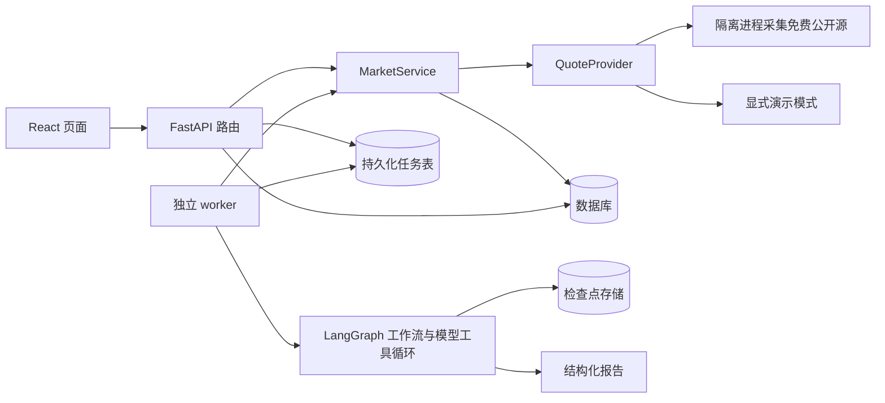

# 架构与数据约定

[返回架构索引](README.md) · [源码导航](source-map.md)

## 模块边界

- Provider 只负责获取并标准化行情，不打分、不操作页面。
- MarketService 负责一次完整快照和提交事务，不解释市场。
- 路由负责请求校验、查询和任务入队；兼容保留短时规则分析接口。
- Graph 负责规则计算和受控模型工具调用，不关心 FastAPI、业务数据库连接或 UI。
- worker 领取任务、管理子进程和超时；run_job 负责图检查点、事件与最终报告事务。
- 前端展示返回值；不复制后端打分公式，避免前后端分数不一致。

直接使用 SQLAlchemy 的 `select` 和 Session，不额外套通用 Repository / BaseService。当前规模下这些抽象只会增加跳转层数。

## 选择同步 SQLAlchemy 的原因

FastAPI 的同步 `def` 路由在线程池中执行，使用同步 Session 更容易理解事务和生命周期。慢速行情采集和模型执行已迁到独立 worker，不占用 HTTP 请求线程；SSE 使用异步生成器，其数据库读取保持短事务。大规模并发时再根据测量结果引入异步数据库或消息队列。

## 表结构

| 表                   | 主要字段                                                                      | 作用                                 |
| -------------------- | ----------------------------------------------------------------------------- | ------------------------------------ |
| market_snapshots     | id、source、as_of、fetched_at、quotes(JSON)                                   | 不可变的行情批次                     |
| analysis_runs        | id、snapshot_id(FK)、symbol、created_at、report(JSON)                         | 可追溯的分析结果                     |
| research_jobs        | id、snapshot_id、mode、model_name、status、lease_owner、lease_until、attempts | 持久化任务与租约                     |
| job_events           | id、job_id、kind、payload、created_at                                         | 可重连的执行进度                     |
| service_states       | key、value、updated_at                                                        | worker 心跳、交易日历与采集状态      |
| model_profiles       | id、name、configuration_id、created_at                                        | 可变配置管理入口，指向不可变版本     |
| model_configurations | id、配置内容、created_at                                                      | 不可变的模型配置版本，密钥仅后端保存 |
| research_snapshots   | key、kind、mode、query_date、data_date、source、observed_at、rows、details    | P2 不可变研究证据                    |
| data_requests        | key、mode、params、status、snapshot_id、error                                 | P2 持久采集队列                      |
| position_lots        | mode、symbol、quantity、cost_price、acquired_on、settlement                   | 用户录入的剩余持仓                   |

`research_jobs.context` 冻结任务提交时的研究证据和显式选择的持仓。模式隔离避免演示数据进入公开研究。资金跨批次差值在查询时派生，绝不改写原始批次。

worker 用两个后台线程分别协调行情和研究采集，各自用有超时的子进程访问网络；主循环继续领取 Agent 任务。研究队列使用条件 UPDATE 领取，只有取得单实例文件锁后才恢复中断请求。页面五分钟读取不意味着每种源每五分钟必定成功。

P1 继续使用按证券类别分批的 JSON 快照，API 读取最新批次后进行内存筛选与分页。它适合单机学习版本，不是长期全市场历史数据库：持续采集会增长存储量，当前没有自动归档。后续应拆出证券主表与行情明细；P3 已用 Parquet / DuckDB 管理量化实验数据版本，但尚未替代行情快照的长期归档。报告引用的快照不能直接删除。

LangGraph 检查点由 SQLiteSaver / PostgresSaver 管理，和这些业务表分开。业务数据库切换 PostgreSQL 不会自动切换检查点，需要配置 CHECKPOINT_POSTGRES_URL。

## API 契约

| 方法 | 路径                  | 行为                                                     |
| ---- | --------------------- | -------------------------------------------------------- |
| GET  | /api/health           | 数据库连接与运行模式                                     |
| GET  | /api/market/quotes    | 最新快照、行情时间、采集时间和 stale 状态                |
| POST | /api/market/refresh   | 返回 202，请求 worker 后台采集；五分钟内重复请求返回 429 |
| GET  | /api/market/status    | worker 心跳、交易时段、各品种采集状态                    |
| GET  | /api/config           | 脱敏配置、模型允许列表                                   |
| POST | /api/jobs             | 返回 202，保存绑定快照与选定模型的任务                   |
| GET  | /api/jobs/{id}/events | 持久化 SSE 事件，支持 Last-Event-ID                      |
| POST | /api/jobs/{id}/cancel | 请求取消任务                                             |
| POST | /api/jobs/{id}/retry  | 明确重试失败任务，从已有检查点恢复                       |
| POST | /api/analyses         | 按 symbol + snapshot_id 分析，成功持久化后返回 201       |
| GET  | /api/analyses         | 分页历史，limit 上限 100                                 |
| GET  | /api/analyses/{id}    | 读取一份不可变报告                                       |

异常输入返回 422，不存在的股票 / 快照 / 报告返回 404。未知异常写入后端日志，API 返回通用错误文本，不把内部堆栈暴露给页面。

## 时间、刷新和故障

- 数据库存 UTC，API 返回带时区时间，页面显示北京时间。
- `quote_time` 是单条行情源时间；批次 `as_of` 是已知源时间的最大值；`fetched_at` 是系统采集完成时间。个股报告不能借用批次时间冒充其源时间。
- 演示样本固定时间为 2026-10-30 15:00（北京时间），并不代表该交易日真实行情；公开行情时间未知时保持 null。
- worker 启动时采集一次，之后默认每 300 秒尝试更新，已知休市时暂停周期采集；不重叠采集，失败保留旧快照。
- 行情页每 300 秒重新读取；后台标签页暂停轮询，重新聚焦时 Query 按新鲜度恢复读取。
- 超过两倍采集周期没有新快照时标记 stale；这只判断采集任务，演示样本始终不具备实时性。
- 采集错误保存在 service_states；前端显示安全错误描述，不回退为演示数据。
- **当前部署一个 API 进程与一个独立 worker。** worker 用操作系统文件锁限制本机单实例，任务领取使用条件 UPDATE；多机部署仍需分布式协调，API 限流也需迁往网关。
- 模型工具调用最多执行配置轮数；每次请求、整个任务和采集进程分别有超时。

## 规则热度分 heat-v1

每一项先截断到 `[0, 1]` 再乘权重，四项得分相加：

| 因子     | 归一化                      | 权重 |
| -------- | --------------------------- | ---- |
| 涨幅强度 | change_pct / 10，负值归零   | 30   |
| 换手活跃 | turnover_pct / 20           | 25   |
| 量比强度 | volume_ratio / 5            | 25   |
| 成交规模 | amount_yuan / 1,000,000,000 | 20   |

它是教学公式，没有回测收益依据，不适合跨板块、流通盘或涨跌停制度比较。高换手可能代表分歧，高成交额也不等于资金净流入。缺失因子不补零，总分返回 null；ETF 和指数不套用股票分数。模型不能修改程序分数。

## P3 量化模块与后续扩展

P3 新增 `quant_datasets` 与 `quant_runs`，分别保存不可变 Parquet 版本清单和实验状态/参数/报告。DuckDB 查询文件，训练和回测在 worker 启动的独立限时子进程执行。最多一个量化进程，与原 Agent 子进程和采集线程独立；默认使用单线程 LightGBM，避免把 CPU 训练放进 API 请求。

`quant/features.py` 与 `quant/backtest.py` 是纯计算模块；`quant/engine.py` 负责滚动拟合和独立校准；`quant/service.py` 管理状态、产物哈希和事务。`frozen_context` 可纳入提交时已完成、证券与历史日期匹配的实验摘要，明确标记不是当前证券预测。数据完整性与算法数值稳定性分别验证，详见 [P3](../modules/quant.md)。

- 新数据源实现 QuoteProvider，并扩展响应中 source / is_demo 的契约；不能只换适配器就去掉演示标签。
- 对照交易所证券主表核验覆盖，完善交易日历和来源延迟监控。
- P2 的研究数据和接口见 [P2 文档](../modules/research.md)；后续补充完整证券主表及可回溯的时点数据。
- 根据实测规模扩展分布式队列、存储与长期归档。
- 概率预测模型与解释模型分开，概率只来自已校准的量化模型。
