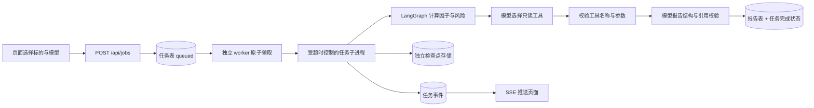

# P1：免费行情与可配置模型 Agent

[返回历史索引](README.md)

> P1 阶段基线，保留模型接入、行情与任务设计说明。当前多配置操作见[模型配置](../modules/model-profiles.md)，量化能力见 [P3](../modules/quant.md)，当前启动方式见[项目 README](../../README.md)。

## 本版范围

P1 延续 P0 的快照和报告模型，加入三类公开行情、模型工具调用、持久化任务、LangGraph 检查点、SSE 进度和单用户访问控制。

数据费用与模型费用分开：行情只用免费公开源；模型优先使用用户已有的 API 服务，由该服务决定费用；Ollama 为本机备选。应用不会自动购买权限、下载模型或在 API 失败后自动换模型。

## 配置模型 API

打开顶部导航「模型设置」（`/settings/models`），填写 API 地址、密钥和可选模型列表，然后选择默认模型并保存。无需重启，行情页「分析模型」下拉框立即使用新配置。模型 ID 必须与供应商一致；输入后按回车添加，可保留多个模型。

「测试 API 连接」使用当前表单执行一次工具调用，不读取行情、不保存配置，会产生供应商定义的调用费用；测试通过不保证完整研究任务一定兼容。「保存设置」本身不会调用模型。更换 API 地址时要求重新填写或清除密钥，不自动把旧密钥传给新供应商。

也可在 `apps/api/.env` 提供初始默认配置，以下域名和模型名都是占位示例：

```dotenv
LLM_BASE_URL=https://your-provider.example/v1
LLM_API_KEY=your-private-key
LLM_MODEL=your-default-model
LLM_MODELS=["your-default-model","your-second-model"]
MODEL_TIMEOUT_SECONDS=60
MAX_TOOL_ROUNDS=3
JOB_TIMEOUT_SECONDS=300
```

适配的是 **OpenAI 兼容 Chat Completions 协议**，模型必须支持 `tools` / `tool_calls`。仅支持纯文本聊天、仅支持 Responses 或仅支持其他厂商原生协议的服务不能直接使用。`Base URL` 通常填到 `/v1`，不要填写完整 `/chat/completions` 路径。

页面保存的配置优先于 `.env`，重启后保留。新提交的模型任务绑定提交时的地址、密钥及模型配置版本，恢复任务不会因页面更换供应商而改用另一套配置。旧版已有任务仍沿用环境配置。默认选择已配置的 API 模型；未配置 API 时使用规则分析。

密钥仅在输入表单和提交请求中出现，保存后清空输入框，查询接口只返回 `has_api_key`，不把密钥保存到浏览器存储或 Query 缓存。服务端本版将配置（包含密钥）保存在业务数据库中，**尚未做静态加密**，数据库及备份应按凭证文件管理。为恢复旧任务，历史配置会保留；「清除当前配置密钥」不删除旧任务绑定的凭证，不代表供应商侧撤销。要彻底失效需在供应商控制台撤销密钥。不要把密钥配置成 `VITE_*` 环境变量。

新增 Alembic 0003 迁移：`model_configurations` 保存不可变配置版本，`research_jobs.model_config_id` 绑定版本，`service_states.model_settings` 指向当前页面配置。设置读取与更新沿用单用户鉴权和写入限流，配置版本冲突返回 409，避免旧页面覆盖刚保存的新值。

### Ollama 备选

```dotenv
OLLAMA_BASE_URL=http://127.0.0.1:11434
OLLAMA_MODEL=qwen3:8b
```

先由用户启动 Ollama 并安装自己选择的、支持工具调用的模型，然后在页面明确选择 Ollama。模型名以本机安装情况为准。当前环境只确认 Ollama 程序存在，没有自动下载或启动模型。

## 免费行情的边界

AKShare 是开源 Python 数据采集库，不是交易所的实时行情授权服务。本项目使用它访问东方财富 / 新浪的公开数据。Tushare 也是国内金融数据接口平台，但接口权限、积分和数据频率有各自限制；本版没有采用 Tushare，也不把它当作免费全市场实时盘口来源。

默认单个来源的采集超时为 180 秒。实测新浪全市场顺序分页超过 75 秒，调整后成功返回；主源失败再尝试备用源会进一步增加耗时。采集不并发叠加，耗时过长时实际更新间隔会超过五分钟。

| 项目 | 本版行为                                               |
| ---- | ------------------------------------------------------ |
| 股票 | 尝试获取公开源返回的沪深北 A 股集合                    |
| ETF  | 获取 ETF 类别的交易行情，不使用基金净值替代成交价      |
| 指数 | 单独读取指数集合，避免股票与指数同代码冲突             |
| 频率 | 默认每 300 秒采集，公开模式不允许小于 300 秒           |
| 延迟 | 无 SLA、无零延迟保证；源时间未知就显示未知             |
| 全量 | 来源返回的数量不是交易所完整性证明，界面明确标注未核验 |
| 缺失 | 显示较上批消失的代码、格式异常数量和缺失字段           |
| 失败 | 保留上一次成功快照，公开模式绝不回退为 DEMO            |
| 盘口 | 不提供逐笔委托、逐笔成交、撤单或委托队列               |

五分钟轮询下，信息显示滞后可能包含：供应商自身延迟、等待下一次采集的时间、批量分页耗时、浏览器读取间隔；失败期间没有延迟上限。因此不能将页面称为“交易所级实时”，也不能将几千条记录视为同一毫秒的全市场快照。

当前优先东方财富，失败后尝试新浪；指数使用新浪。来源切换以整批为单位并保存来源，不混合不同供应商的资金口径。第三方网页与接口可能限流、调整字段或停止服务。免费可访问不等于授予公开转售或数据再分发权限。

### 交易日历

交易日历来自公开接口并缓存；只在日期范围覆盖今天时判定交易日。周末可确定休市；工作日若日历未覆盖，状态显示未知，不用星期几代替节假日数据。确认休市后不做周期性的全市场采集，首次启动和手动刷新仍允许读取最近行情。

### 数据含义

- `quote_time`：单条行情的源时间；只有时分秒但没有日期时不补造日期。
- `as_of`：批次中已知的最新源时间，不代表所有标的同时更新。
- `fetched_at`：本系统完成本批采集的时间。
- `stale`：距采集完成超过两个配置周期。休市也保留真实时间，不能借休市刷新标记伪装新数据。
- 缺少某个评分因子时，不计算总分。ETF 和指数不使用股票热度总分。

## 请求链路



图采用标准 StateGraph、普通节点与条件边。模型选择 `read_quote`、`read_factors`、`read_risks` 三个工具，程序限制工具名称、参数和调用轮数。工具只读绑定快照，不访问文件、终端或任意 URL。

报告由两个部分构成：程序计算的规则摘要、模型输出的解释。模型无权修改程序分数。结构校验与证据 ID 校验不能证明每句自然语言都正确，因此原始证据与模型文字同时展示。

## 任务恢复与取消

- 数据库任务是持久队列，API 返回 202 和 job_id，不等模型返回才响应页面。
- worker 通过条件 UPDATE 领取 queued 任务，操作系统文件锁限制本机一个 worker。
- 任务包含租约，进程中断后租约到期会重新排队；超过最大尝试次数则失败。
- LangGraph 使用 job_id 作为 thread_id，SQLite / PostgreSQL 检查点独立于业务报告。
- 恢复时调用 `graph.stream(None, config)`；已完成的节点不重新传初始输入覆盖。
- 普通模型错误不自动反复调用；用户明确点击重试。超时、取消会终止任务子进程。
- 外部 API 的调用不是 exactly-once：响应成功但检查点尚未提交时中断，重试可能重复调用和计费。
- 报告 ID 等于任务 ID，成功报告不会在重试时重复生成。
- 取消不会保证模型供应商已停止远端计算，已产生费用由供应商规则决定。

SSE 事件保存到数据库，携带事件 ID；重连可从 Last-Event-ID 续读。页面还会轮询任务状态，避免事件连接暂时失败后无法看到最终结果。

## 访问控制与部署范围

```dotenv
APP_ENVIRONMENT=production
APP_API_KEY=replace-with-at-least-32-random-characters
CORS_ORIGINS=["https://your-app.example"]
```

应用访问密钥与模型 API Key 是两种不同凭证。生产模式必须设置至少 32 字符的访问密钥。登录后使用 HttpOnly、SameSite=Strict cookie；生产 cookie 要求 HTTPS。API 客户端也可使用 Bearer 访问密钥。

这是**单用户、单机部署**：所有通过访问密钥的人共享数据和任务。API 提供有界进程内限流、登录限流和队列容量限制；跨机器、多用户权限隔离与分布式限流不在本版范围。

外网部署还需要 HTTPS 反向代理，`/api` 转发后端，SSE 禁用代理缓冲，页面路由配置 SPA fallback。默认启动脚本只绑定 127.0.0.1，不会自动公开服务。

## 文件入口

| 文件                     | 阅读重点                         |
| ------------------------ | -------------------------------- |
| app/providers/public.py  | 字段标准化、未知时间、备用数据源 |
| app/providers/collect.py | 隔离第三方采集 SDK               |
| app/services/market.py   | 按品种保存快照、服务端筛选与分页 |
| app/services/jobs.py     | 入队、领取、事件、租约恢复       |
| app/worker.py            | 后台采集与任务子进程生命周期     |
| app/agents/models.py     | API / Ollama 模型适配            |
| app/agents/assistant.py  | 工具循环、条件边、结构化输出     |
| app/agents/run_job.py    | 检查点恢复、报告与任务事务       |
| app/core/security.py     | 访问密钥、cookie 与限流          |
| src/pages/Jobs.tsx       | SSE 与任务状态交互               |

## 仍属于后续版本

以上为 P1 的历史范围。龙虎榜、资金流向、连板梯队、持仓和十年案例现已在 [P2](../modules/research.md) 接入；[P3](../modules/quant.md) 已提供滚动校准和受成交约束的回测研究版，仍不代表实盘能力。接入模型不会自动获得数据。真实交易所证券名录交叉核验、Level-2 授权和长期历史归档尚未实现。

## 数据与框架参考

- [AKShare 股票行情](https://akshare.akfamily.xyz/data/stock/stock_quote.html)
- [AKShare 基金数据](https://akshare.akfamily.xyz/data/fund/fund_public.html)
- [AKShare 指数数据](https://akshare.akfamily.xyz/data/index/index.html)
- [LangGraph 持久化](https://docs.langchain.com/oss/python/langgraph/persistence)
- [Ollama 工具调用](https://docs.ollama.com/capabilities/tool-calling)

OpenAI 官方工具调用文档在本次环境访问返回 403；兼容 API 通过已安装的 LangChain ChatOpenAI 接口实现，并以协议测试验证。具体供应商能否兼容仍需用户配置后联调。
